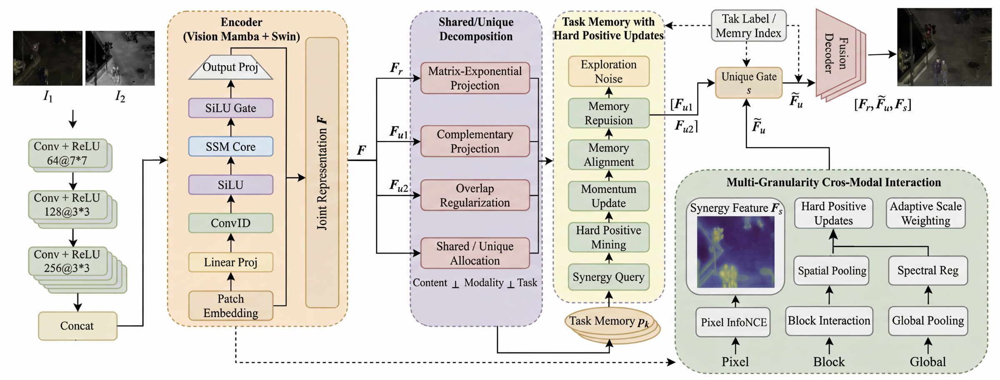
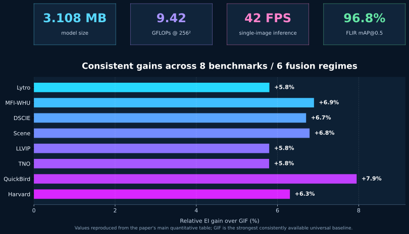
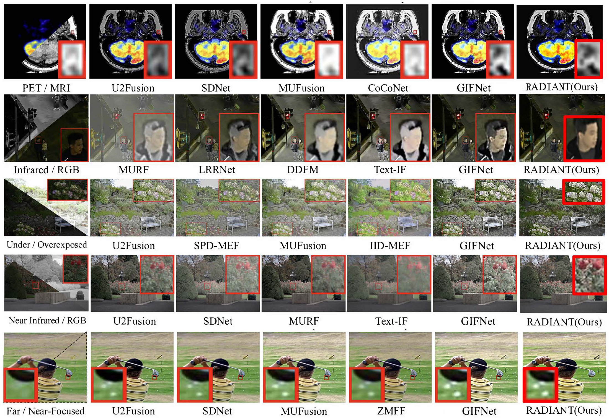
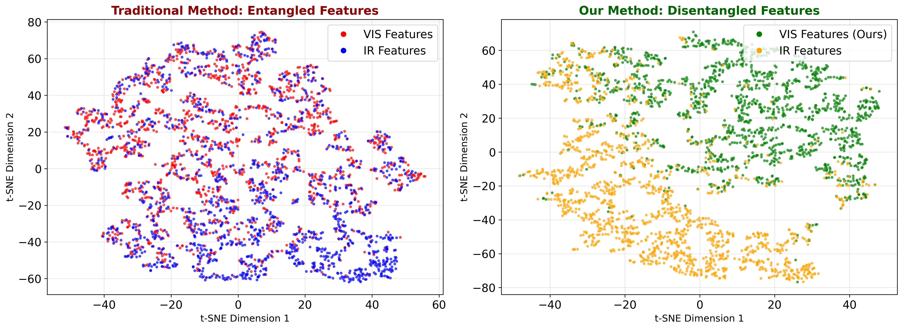

<div align="center">


### RADIANT: Redundancy-Aware Information Allocation for Universal Multi-Modal Fusion

[](https://doi.org/10.1145/3767308.3836335)
[](https://www.python.org/)
[](https://pytorch.org/)
[](https://doi.org/10.1145/3767308.3836335)

**Shenghai Wu · Yue Lin**

[Paper](https://doi.org/10.1145/3767308.3836335) · [Overview](#method-overview) · [Results](#results-at-a-glance) · [Quick Start](#quick-start) · [Citation](#citation)

</div>

RADIANT treats universal multi-modal fusion as **task-conditioned information allocation**. It suppresses redundant overlap, preserves modality-unique evidence, and composes task-dependent synergy through memory-guided cross-modal interaction.
 

## Why RADIANT?

| Shared evidence | Unique evidence | Task synergy |
|:---:|:---:|:---:|
| Reduce harmful cross-modal overlap with non-interfering projections. | Preserve weak modality-specific cues that conventional alignment may smooth away. | Activate pixel-, block-, and global-scale interactions using task memory. |

## Method overview

<p align="center">
  
</p>

The pipeline combines a compact Vision Mamba-Swin encoder, matrix-exponential shared/unique decomposition, task memory with hard-positive updates, and adaptive multi-granularity interaction. The decoder receives shared evidence, selectively preserved unique evidence, and task-conditioned synergy.

## Results at a glance

<p align="center">
  
</p>

### Quantitative comparison

EI results from the main paper are shown below. GIF is used because it is the strongest universal baseline reported consistently across all eight benchmarks.

| Fusion regime | Benchmark | GIF | RADIANT | Relative gain |
|---|---:|---:|---:|---:|
| Multi-focus | Lytro | 80.86 | **85.55** | **+5.8%** |
| Multi-focus | MFI-WHU | 91.61 | **97.93** | **+6.9%** |
| Multi-exposure | DSCIE | 111.27 | **118.73** | **+6.7%** |
| NIR-visible | Scene | 101.32 | **108.20** | **+6.8%** |
| Infrared-visible | LLVIP | 62.46 | **66.08** | **+5.8%** |
| Infrared-visible | TNO | 52.30 | **55.33** | **+5.8%** |
| Remote sensing | QuickBird | 23.02 | **24.85** | **+7.9%** |
| Medical | Harvard | 100.71 | **107.06** | **+6.3%** |

### Qualitative comparison

<p align="center">
  
</p>

RADIANT preserves thermal saliency, fine texture, exposure balance, focus boundaries, and complementary anatomical-functional information across heterogeneous fusion regimes.

### Information allocation visualization

<p align="center">
  
</p>

The visualization illustrates the intended non-interference bias: conventional features remain strongly entangled, while RADIANT encourages clearer allocation of shared and modality-specific evidence. This is an empirical diagnostic, not a claim of identifiable partial-information decomposition.

## Quick start

### 1. Create the environment

Using Conda:

```bash
conda env create -f environment.yml
conda activate radiant
```

Or install with pip after selecting the appropriate PyTorch build for your machine:

```bash
pip install -r requirements.txt
```

### 2. Run the smoke test

```bash
python smoke_test.py
```

The smoke test checks the RADIANT forward pass, backward pass, finite gradients, and checkpoint round-trip on CPU.

### 3. Prepare paired training data

```text
train_data/
├── infrared/train/
├── visible/train/
├── visible_focus_near/train/
└── visible_focus_far/train/
```

Files in all four streams are paired by filename stem. Supported extensions are BMP, JPEG, PNG, and TIFF.

### 4. Train

```bash
python train.py \
  --train-data-root ./train_data \
  --checkpoint-dir ./checkpoints \
  --run-dir ./runs \
  --device cuda \
  --amp
```

For a one-step integration check:

```bash
python train.py --train-data-root ./train_data --device cpu --dry-run --max-samples 2
```

### 5. Fuse a pair directory

```bash
python infer.py \
  --source1-root ./examples/inputs/IVIF/ir \
  --source2-root ./examples/inputs/IVIF/vis \
  --source2-rgb \
  --task ivif \
  --checkpoint ./checkpoints/radiant_best.pt \
  --save-path ./outputs/ivif
```

Supported task keys:

| Key | Task |
|---|---|
| `ivif` | Infrared-visible fusion |
| `mfif` | Multi-focus fusion |
| `meif` | Multi-exposure fusion |
| `nir-vis` | Near-infrared-visible fusion |
| `remote` | Remote-sensing fusion |
| `medical` | Medical image fusion |

## Project structure

```text
RADIANT/
├── assets/                  # README and paper visualizations
├── checkpoints/             # RADIANT and compatibility checkpoints
├── examples/inputs/         # Small multi-task input examples
├── legacy/                  # Preserved prototype utilities
├── third_party/             # Vendored third-party components
├── tools/                   # Visualization and preprocessing tools
├── radiant_config.py        # Default model/training configuration
├── radiant_dataset.py       # Stem-paired collaborative dataset
├── radiant_modules.py       # Allocation, interaction, and task memory
├── radiant_model.py         # RADIANT model and loss
├── train.py                 # Training entry point
├── infer.py                 # Multi-task inference entry point
└── smoke_test.py            # CPU integration test
```

## Reproducibility notes

- Inputs are resized to `256 × 256` by the released training pipeline.
- The default optimizer is AdamW with cosine annealing.
- Checkpoints store the model, optimizer, scheduler, epoch, best loss, and complete CLI configuration.
- Dataset files are not redistributed. Download each benchmark from its official source and follow its license.
- Run `python tools/make_readme_visuals.py` to regenerate the performance dashboard.

## Citation

```bibtex
@inproceedings{wu2026radiant,
  title     = {RADIANT: Redundancy-Aware Information Allocation for Universal Multi-Modal Fusion},
  author    = {Wu, Shenghai and Lin, Yue},
  booktitle = {Proceedings of the 34th ACM International Conference on Multimedia},
  year      = {2026},
  doi       = {10.1145/3767308.3836335}
}
```

## Contact

For questions about the paper or code, contact **Shenghai Wu** at `stevenwsh01@gmail.com`.

